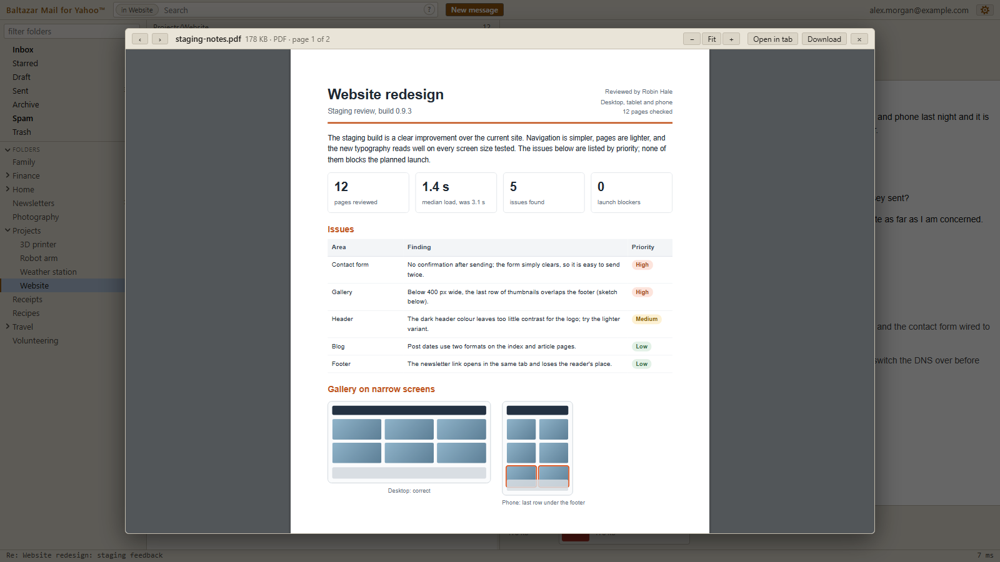
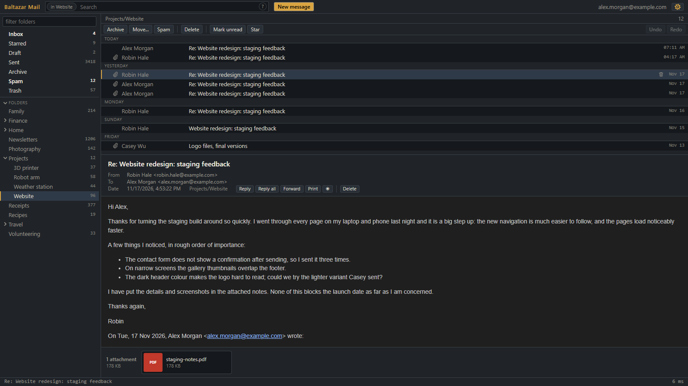
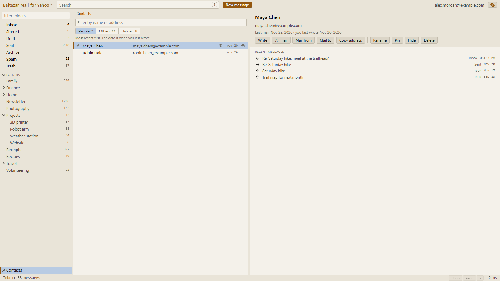
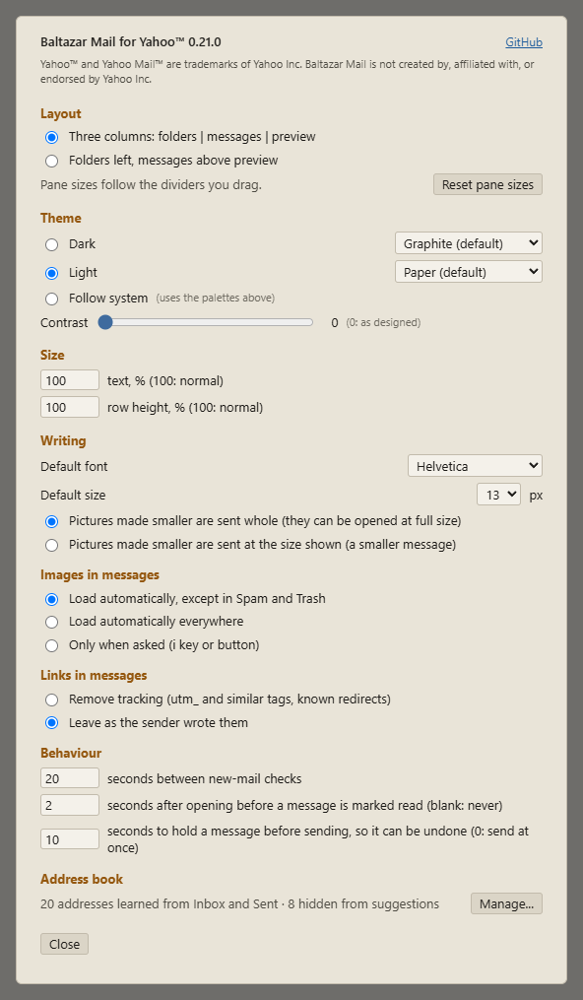

# Baltazar Mail

A fast, ad-free mail client for Yahoo Mail™ and Gmail™, as an extension for Chrome, Edge and other Chromium browsers. It comes in two editions, which can be installed side by side:

- **Baltazar Mail**, for Yahoo™, uses the Yahoo sign-in already in your browser. There is nothing to set up.
- **Baltazar Mail for Gmail** signs in with your Google™ account. Its sign-in page guides you through a one-time setup of about two minutes.

No server, no analytics, no ads: your mail goes only between your browser and your mail service.

## Features

Everything a mail client does, and:

- **Attachments open in place:** PDF, Office documents, spreadsheets, pictures and ZIP listings, without downloading. Right-click to download several at once in one ZIP file.
- **A folder's attachments in one list:** right-click a folder › Show attachments lists every attachment in its mail, with its subfolders' if you like, such as the tickets and itineraries of a trip.
- **Contacts in one list:** everyone in your mail, learned from the message headers and suggested as you write. Pin, hide, rename or delete them, write to several at once, and export the list to a text file you can edit and import back.
- **Sixteen light and dark palettes**, with a dark mode that darkens the messages to match.
- **Undo for everything:** several levels of undo and redo for mailbox actions, and undo-send.
- **Tracking pictures removed** from every message, and **tracking removed from links** when you switch it on.
- **A new-mail dot** on the tab and the toolbar button, handy for a pinned tab.
- **Keyboard shortcuts** throughout; press `?` in the app.

[docs/features.md](docs/features.md) describes every feature, and what differs in the Gmail edition.

All names, addresses and messages in these screenshots are invented.

## Install

**Yahoo, from a store:** install Baltazar Mail from the [Chrome Web Store](https://chromewebstore.google.com/detail/baltazar-mail/kkphbfhheikioedcgnjmeldabekdcnib) or from [Microsoft Edge Add-ons](https://microsoftedge.microsoft.com/addons/detail/baltazar-mail/fmfafokapbejponlbknighiecagfcnai). Be signed in to mail.yahoo.com in the same browser profile, then click the Baltazar Mail toolbar button.

**Gmail, or any Chromium browser (version 147 or later), from a ZIP:**

1. Download `baltazar-mail-gmail-<version>.zip` or `baltazar-mail-yahoo-<version>.zip` from the [latest release](https://github.com/gdevic/baltazar-mail/releases/latest) and unzip it into a folder you will keep.
2. Open `chrome://extensions` (or `edge://extensions`) and turn on **Developer mode**.
3. Click **Load unpacked** and select the `baltazar-mail-gmail` or `baltazar-mail-yahoo` folder.
4. Gmail: the extension opens its tab and guides you through the sign-in ([each step, with pictures](docs/gmail-sign-in.md)). Yahoo: be signed in to mail.yahoo.com, then click the toolbar button.

To update a ZIP copy, unzip the new release over the same folder and click **Reload** on the extensions page. [docs/install.md](docs/install.md) has the details.

## Security and privacy

Each extension talks only to its mail service, with two exceptions: a ZIP copy asks GitHub once a day whether a newer release exists, sending nothing about you or your mail, and in the Gmail edition images in messages load from their senders' servers when your setting allows. Attachments are read in a sandbox with no access to your session. See [SECURITY.md](SECURITY.md) and [PRIVACY.md](PRIVACY.md).

## License

MIT, see [LICENSE](LICENSE). The bundled third-party libraries keep their own licences, listed in [`ext/vendor/README.md`](ext/vendor/README.md).

Baltazar Mail is an independent project by [Baltazar Studios](https://baltazarstudios.com). Yahoo and Yahoo Mail are trademarks of Yahoo Inc., and Gmail and Google are trademarks of Google LLC. Baltazar Mail and Baltazar Mail for Gmail are not created by, affiliated with, or endorsed by Yahoo Inc. or Google LLC.
