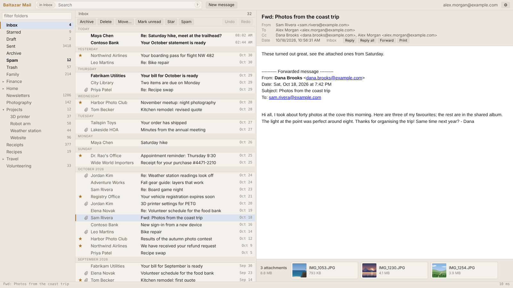
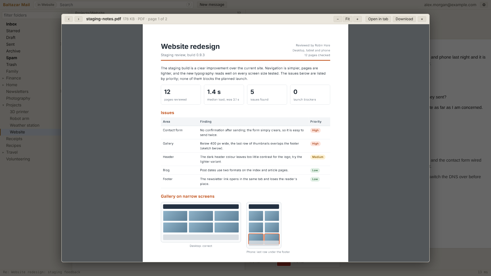
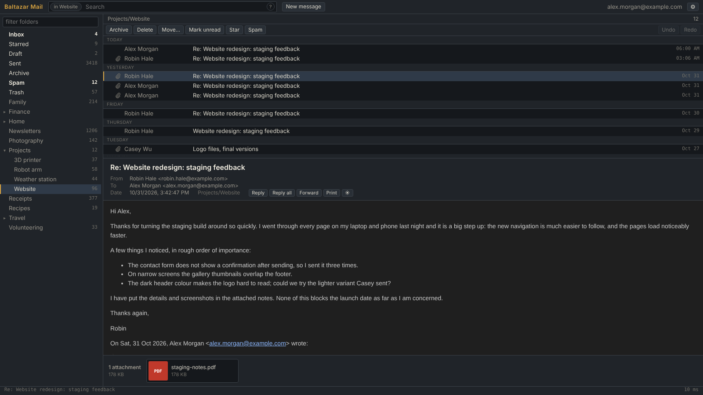
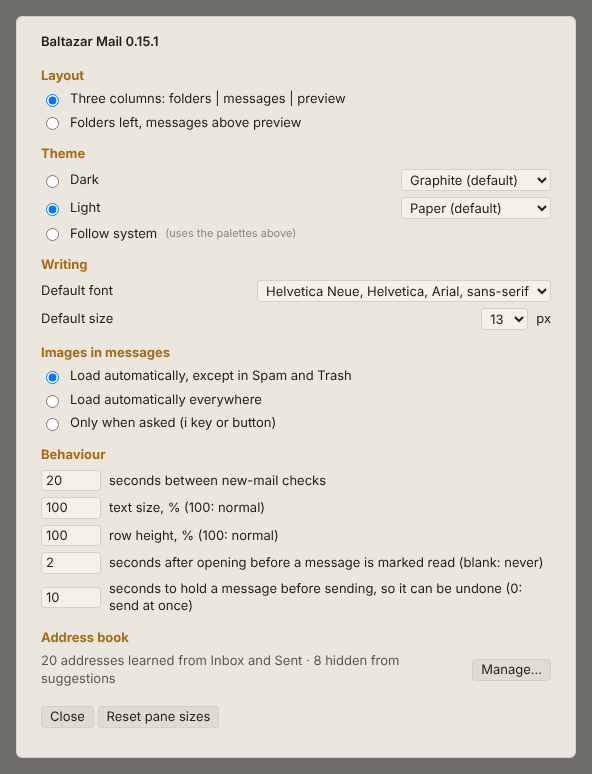

# Baltazar Mail

A fast, ad-free client for Yahoo Mail, packaged as a Chromium (Edge/Chrome) extension. It reuses the Yahoo sign-in already present in the browser and talks to the same API that Yahoo's own web client uses, so it is as quick as the official UI without any of its clutter. Everything works with the mouse; press `?` in the app for keyboard shortcuts.

Baltazar Mail is an independent project by [Baltazar Studios](https://baltazarstudios.com) and is not affiliated with Yahoo.

## Features

- **Reading:** three-column or stacked layout with resizable panes, sixteen palettes, eight light and eight dark in a range of hues and mostly in light and dark pairs (two of them plain black and white), a contrast slider, one text size setting that scales the whole interface and the message, a row height setting, a Starred view across all folders, and remote images loaded automatically except in Spam and Trash. In a dark theme messages are darkened to match, keeping their colours' hues and leaving images alone; the ☀ button in the message header shows them in their original colours instead.
- **Mailbox actions:** read/unread, star, archive, move, delete, spam and not spam, on one message or a selection, with multi-level undo and redo.
- **Search:** scoped to the open folder and its subfolders, with matches in other folders listed below a divider. Words must all match; `AND`, `OR`, `NOT` (or a leading `-`), parentheses, quoted phrases and the fields `from:` `to:` `subject:` `has:attachment` `is:starred` `is:read` `is:unread` `after:` `before:` refine it. The `?` in the search box explains the syntax.
- **Writing:** new message, reply, reply all and forward (with the original's attachments), drafts saved automatically, rich-text or plain-text editing with fonts, sizes and colours, pasted or dropped inline images, attachments, and undo-send.
- **Address book:** built from your own Inbox and Sent headers, with autocomplete ranked by recency and use. Automated senders you never wrote to (noreply, notifications, bulk-mail domains) are left out of suggestions. Settings › Address book lists it with a filter and hide/restore, also in bulk.
- **Attachments:** listed under the message and previewed in place: PDF with selectable text and zoom, Word, Excel and other spreadsheets, PowerPoint and older Office formats through Yahoo's converter, images, text and code, CSV, HTML, audio, video and ZIP listings. Anything else up to 100 KB can be read as text, or as a hex dump when it is binary.
- **Also:** a red dot on the tab icon and toolbar button when new mail arrives while the tab is in the background (handy for a pinned tab), contact cards (right-click a message › About sender, or hover an address in the message header), printing, anything that failed shown in a bar under the top bar (with details to copy for a bug report), and all settings kept between sessions.

Attachments open in place, here a two-page PDF with selectable text and zoom; photos, Office documents and spreadsheets open the same way:

The dark theme with the message list above the preview; the message is darkened to match:

Settings:

All names, addresses and messages in these screenshots are invented; `node tools/screenshots.js` regenerates them.

## Install

**Microsoft Edge:** install [Baltazar Mail from Microsoft Edge Add-ons](https://microsoftedge.microsoft.com/addons/detail/baltazar-mail/fmfafokapbejponlbknighiecagfcnai). Edge keeps it up to date. Be signed in to mail.yahoo.com in the same browser profile, then click the Baltazar Mail toolbar icon.

**Chrome and other Chromium browsers**, or to run a release before it reaches the store (Chrome or Edge 147 or later, or another browser built on Chromium 147 or later):

1. Download `baltazar-mail-<version>.zip` from the [latest release](https://github.com/gdevic/baltazar-mail/releases/latest) and unzip it into a folder you will keep; it contains one folder, `baltazar-mail`.
2. Open `chrome://extensions` (or `edge://extensions`) and turn on Developer mode.
3. Click Load unpacked and select the `baltazar-mail` folder.
4. Be signed in to mail.yahoo.com in the same browser profile, then click the Baltazar Mail toolbar icon.

A copy installed this way says in Settings when a newer release is out. To update, put the new release's files into the same `baltazar-mail` folder, replacing the old ones, and click Reload on the extensions page. Windows' Extract All offers a new folder by default, so point it at the folder that contains `baltazar-mail` and confirm replacing the files; macOS's Archive Utility never replaces files, so use `unzip -o baltazar-mail-<version>.zip -d <that folder>` in Terminal. Loading the new release from a different folder, or removing the extension, would start over without its settings and address book. From a clone of this repository, load the `ext/` folder the same way.

Moving from a ZIP install to the Edge Add-ons copy: the store copy is a separate extension, so set your preferences again once; its address book rebuilds itself from your mail. Then remove the ZIP copy so only one toolbar button remains.

**Microsoft Edge: keep the tab awake.** Baltazar Mail asks the browser not to discard its tab, which keeps Chrome's Memory Saver from unloading it. Edge also puts background tabs to sleep, pinned ones included, and a sleeping tab cannot check for new mail until you click it. To keep Baltazar Mail checking in Edge (and the new-mail dot working), add it to Edge's exception list once:

1. Open `edge://settings/system` and find **Always keep these sites active** (older versions: "Never put these sites to sleep"). Click **Add site**.
2. Enter `chrome-extension://<ID>/`, with the `chrome-` prefix and the trailing slash, where `<ID>` is your copy's 32-letter extension ID:
   - Installed from Microsoft Edge Add-ons: `fmfafokapbejponlbknighiecagfcnai`, the same everywhere.
   - Installed from a release ZIP: an ID Edge derives from the folder you loaded, different on each computer or folder (it stays the same when you unzip updates over the same folder).

   Either way, the ID is in the address bar of the Baltazar Mail tab, after `chrome-extension://`, and on `edge://extensions` with Developer mode turned on.
3. To confirm, open `edge://discards`: the Baltazar Mail tab should show that it cannot sleep.

Extensions cannot add themselves to this list.

To publish a release, set `version` in `ext/manifest.json`, commit, and run the Release workflow from the Actions tab with a matching tag (for example `v0.17.0`). It runs every test suite, then builds the install ZIP and the store ZIP (`-store.zip`, with `manifest.json` at the top level) and creates the release.

Baltazar Mail relies on an undocumented Yahoo API that can change at any time; what is known about it is in `docs/yahoo-v3.md`.

## Security and privacy

The extension talks only to Yahoo, with one exception: a copy loaded with Load unpacked (a release ZIP or a clone) asks GitHub once a day whether a newer release exists (an hour later after a failed check), sending no cookies and nothing about you or your mail. It has no server, analytics or telemetry, and parses attachments in a sandbox with no access to your session. Details are in [SECURITY.md](SECURITY.md), including how to report a vulnerability, and in [PRIVACY.md](PRIVACY.md), including every host contacted, everything stored and every permission.

## License

MIT, see [LICENSE](LICENSE). The bundled third-party libraries keep their own licences (Apache-2.0 and MIT), listed in [`ext/vendor/README.md`](ext/vendor/README.md).
