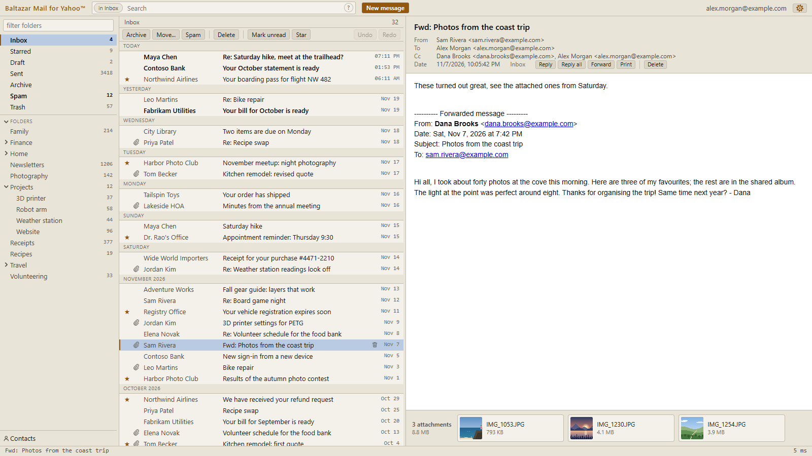

# Baltazar Mail

A fast, ad-free mail client packaged as a Chromium (Edge/Chrome) extension, in two editions that share their code and can be installed side by side:

- **Baltazar Mail**, for Yahoo Mail™. It reuses the Yahoo™ sign-in already present in the browser and talks to the same API that Yahoo's own web client uses, so it is as quick as the official UI without any of its clutter. Its page and tab show it as Baltazar Mail for Yahoo.
- **Baltazar Mail for Gmail™**. It signs in with your Google™ account through a Google client of your own, which its sign-in page helps you make in about two minutes, once, and talks to the Gmail API; labels appear as folders, All Mail stands in for the archive.

Everything works with the mouse; press `?` in the app for keyboard shortcuts.

Baltazar Mail is an independent project by [Baltazar Studios](https://baltazarstudios.com). Yahoo and Yahoo Mail are trademarks of Yahoo Inc., and Gmail and Google are trademarks of Google LLC. Baltazar Mail and Baltazar Mail for Gmail are not created by, affiliated with, or endorsed by Yahoo Inc. or Google LLC.

## Features

- **Reading:** three-column or stacked layout with resizable panes, sixteen palettes, eight light and eight dark in a range of hues and mostly in light and dark pairs (two of them plain black and white), a contrast slider, one text size setting that scales the whole interface and the message, a zoom for the message pane alone, read or written, shown for a moment over the pane (+, - and 0, Ctrl+= / Ctrl+- / Ctrl+0 in the composer, or Ctrl+wheel over it), a row height setting, a Starred view across all folders but Spam and Trash, and remote images loaded automatically except in Spam and Trash. In a dark theme messages are darkened to match, keeping their colours' hues and leaving images alone; the ☀ button in the message header shows them in their original colours instead.
- **Links:** Settings › Links in messages can remove tracking from the links in mail (off by default). Tags such as `utm_source`, `fbclid`, `mc_eid` and `_hsenc` are dropped, and a redirect that carries its destination (Google, YouTube, Facebook, Instagram, Outlook SafeLinks, Substack) is replaced by that destination, also cleaned. It applies to the reader, printing, HTML attachments and the quote in a reply or forward, so a forwarded newsletter does not hand on your subscriber id; links you paste into your own message are left as they are. It is done without any request, so a link through a mailing service's own click tracker (Mailchimp, SendGrid and most others), whose destination is not in the link, stays as it is: finding out where it goes would mean visiting it, which is the click it records. Changing the setting redraws the open message, so a link the cleaning broke can be had as the sender wrote it.
- **Mailbox actions:** read/unread, star, archive, move, delete, spam and not spam, on one message or a selection (click, Shift-click for a range, Ctrl-click for single rows), with multi-level undo and redo. A trash icon beside each row's date deletes it without opening it. The reader has its own Delete button, for the open message alone; for a message in Trash it reads Undelete and moves it to Inbox without asking. Right-click a message for these and for Reply, Reply all, Forward and Find all from, with each shortcut shown.
- **Folders:** right-click a folder to create a subfolder, rename, move or delete it (only when it and its subfolders are empty), or mark it all read; right-click Trash or Spam to empty it. The Folders heading above your own folders creates top-level folders and opens or closes the first level of subfolders; a double click opens or closes one folder. Subfolders of Inbox are shown under Inbox, as Yahoo files them.
- **Search:** scoped to the open folder and its subfolders, with matches in other folders (Spam and Trash aside) listed below a divider. Words must all match; `AND`, `OR`, `NOT` (or a leading `-`), parentheses, quoted phrases and the fields `from:` `to:` `subject:` `has:attachment` `is:starred` `is:read` `is:unread` `after:` `before:` refine it. The `?` in the search box explains the syntax.
- **Writing:** new message, reply, reply all and forward (with the original's attachments), drafts saved automatically, rich-text or plain-text editing with fonts, sizes and colours, pasted or dropped inline images, attachments, and undo-send. Click a picture in the message to size it (Small, Medium, Large, Original, or drag its corner) or delete it (Ctrl+Z brings it back). A picture made smaller is sent whole, as Gmail and Outlook do, so it can be opened at full size; Settings › Writing can send it at the size shown instead, for a smaller message (twice the shown width, so it stays sharp on high-density screens; GIFs go whole to keep their animation, and drafts always keep the whole picture).
- **Address book:** built from your own Inbox and Sent headers, with autocomplete ranked by how recently you wrote to or heard from each person. Automated senders you never wrote to (noreply, notifications, bulk-mail domains) are left out of suggestions. Settings › Address book lists it with a filter and hide/restore, also in bulk.
- **Attachments:** listed under the message and previewed in place: PDF with selectable text and zoom, Word, Excel and other spreadsheets, PowerPoint, older Word, RTF and OpenDocument text and slides through Yahoo's converter, images, text and code, CSV, HTML, audio, video and ZIP listings. Anything else up to 100 KB can be read as text, or as a hex dump when it is binary.
- **Also:** a red dot on the tab icon and toolbar button when new mail arrives while the tab is in the background, or arrived while the browser was closed and the tab opens in the background (handy for a pinned tab), contact cards (right-click a message › About sender..., or hover an address in the message header) with the person's recent messages, each opening in its folder, printing, anything that failed shown in a bar under the top bar (with details to copy for a bug report), and all settings kept between sessions.

Attachments open in place, here a two-page PDF with selectable text and zoom; photos, Office documents and spreadsheets open the same way:

The dark theme with the message list above the preview; the message is darkened to match:

Settings:

All names, addresses and messages in these screenshots are invented; `node tools/screenshots.js` regenerates them.

### Gmail: what differs

The Gmail edition has the same interface and the same features, with these differences that come from Gmail itself: Gmail's labels are the folders (a message with no label is in All Mail, and Archive moves it there); a move takes the message out of the folder it is shown in and keeps its other labels, also in Trash and Spam, and undo puts back exactly what the move changed; Spam and Trash are Gmail's; Mark all read, Empty Trash and Empty Spam work on the label, 100,000 messages at a time; renaming a folder renames the labels nested under it. There is no document converter, so PowerPoint, Keynote, older Word, RTF and OpenDocument text and slides offer Download (and, up to 100 KB, a text or hex view) instead of a preview (PDF, Word .docx, spreadsheets of every kind, images, text and ZIP preview as before). Images in messages load straight from the senders' servers when the setting allows, since Gmail's API hands over the message as the sender wrote it (see [PRIVACY.md](PRIVACY.md)). Gmail's API has a quota per user (by default 6,000 units a minute, where a list of 100 messages costs about 500), so the extension paces its requests and builds the address book over time: starting two minutes after the mailbox first opens, it reads the newest 2,000 messages of each of Inbox and Sent a little at a time, only once you have left the app alone for a minute (or its tab is in the background), which adds up to about 40 minutes and carries on across sessions; until it is done, address suggestions come from what has been read so far. How the adapter maps Gmail onto the client is in `docs/gmail-api.md`.

## Install

**Baltazar Mail** (Yahoo Mail): in Chrome, install [Baltazar Mail from the Chrome Web Store](https://chromewebstore.google.com/detail/baltazar-mail/kkphbfhheikioedcgnjmeldabekdcnib); in Microsoft Edge, install [Baltazar Mail from Microsoft Edge Add-ons](https://microsoftedge.microsoft.com/addons/detail/baltazar-mail/fmfafokapbejponlbknighiecagfcnai). Either store keeps it up to date. Be signed in to mail.yahoo.com in the same browser profile, then click the Baltazar Mail toolbar icon.

**Baltazar Mail for Gmail**, other Chromium browsers, or a release before it reaches the stores: install from a release ZIP in Chrome, Edge or another browser built on Chromium, version 147 or later:

1. Download `baltazar-mail-yahoo-<version>.zip` (Yahoo) or `baltazar-mail-gmail-<version>.zip` (Gmail) from the [latest release](https://github.com/gdevic/baltazar-mail/releases/latest) and unzip it into a folder you will keep; it contains one folder, `baltazar-mail-yahoo` or `baltazar-mail-gmail`.
2. Open `chrome://extensions` (or `edge://extensions`) and turn on Developer mode.
3. Click Load unpacked and select that folder.
4. Yahoo: be signed in to mail.yahoo.com in the same browser profile, then click the Baltazar Mail toolbar icon. Gmail: the extension opens its tab by itself when first loaded (later, click the Baltazar Mail for Gmail toolbar icon). Its sign-in page guides you through making a free Google client of your own ([each step, with pictures](docs/gmail-sign-in.md)), then you press Sign in with Google; Google asks for the account and the permission once, and the extension renews the sign-in silently afterwards, for that account only (Sign out, at the top of Settings, asks first, then withdraws the permission and clears the address book; the client stays, so signing in again is one press).

A copy installed this way says in Settings when a newer release is out. To update, put the new release's files into the same folder, replacing the old ones, and click Reload on the extensions page. Windows' Extract All offers a new folder by default, so point it at the folder that contains `baltazar-mail-yahoo` (or `baltazar-mail-gmail`) and confirm replacing the files; macOS's Archive Utility never replaces files, so use `unzip -o baltazar-mail-yahoo-<version>.zip -d <that folder>` in Terminal. Loading the new release from a different folder, or removing the extension, would start over without its settings and address book. From a clone of this repository, run `node tools/build.js` and load `dist/baltazar-mail-yahoo` or `dist/baltazar-mail-gmail` the same way; after a change, build again and click Reload on the extension's card.

A ZIP copy in a folder named `baltazar-mail`, from an earlier release or the original Baltazar Mail, is a different extension from one in `baltazar-mail-yahoo`: load `baltazar-mail-yahoo` with Load unpacked, set your preferences again once (its address book rebuilds itself from your mail), then remove the old copy.

Moving from a ZIP install to a store copy: the store copy is a separate extension, so set your preferences again once; its address book rebuilds itself from your mail. Then remove the ZIP copy so only one toolbar button remains.

**Gmail and Google's sign-in.** Google lets an app reach Gmail only through an OAuth client registered with Google, and Baltazar Mail has no server or shared client, so each user makes one of their own, free. The sign-in page walks through it step by step, with a Copy button for this copy's redirect address and a button for each page of Google's. The quick way is Google's Personal mode: one page, no review by Google and no warning, but only the account that made the client can sign in with it. The classic way, for several accounts or a work or school organization, takes a few more steps and shows Google's "unverified app" screen at each first sign-in. When a sign-in fails, the page says why and what to do, including for each error Google's own window can show. A release ZIP, and any copy built from this repository, has the extension id `enejfhgeailmbkfpdgfdlajlfhnnbafd` wherever its folder is, so its redirect address never changes. [docs/gmail-sign-in.md](docs/gmail-sign-in.md) shows each step of the sign-in page with pictures; `docs/google-setup.md` has the same guide as text, the classic setup, every error and its fix, and what a shared one-click client for a store would need.

**Staying awake in the background.** A browser may put a tab you have left to sleep: Edge does it to every background tab after a set time, pinned ones included, and Chrome to a tab that works hard while Energy Saver is on. A sleeping tab cannot check for new mail until you click it, so the new-mail dot stops working. Baltazar Mail keeps its tab awake by itself while you are signed in, with nothing to set up: it holds a Web Lock, which both browsers leave awake, and asks the browser not to discard the tab, which keeps Chrome's Memory Saver from unloading it. Settings › Behaviour has the switch, on unless you turn it off (staying awake costs a little power), and says under it whether the browser put the tab to sleep in the last 7 days and for how long. The **Browser's own setting** link beside it opens the other way to stay awake: this copy's address with a Copy button, to add to the browser's own list of sites it never puts to sleep. Should a tab that was to stay awake sleep all the same, a note says so once and leads there.

The same by hand in Edge, which no extension can do for you:

1. Open `edge://settings/system` and find **Always keep these sites active** (older versions: "Never put these sites to sleep"). Click **Add site**.
2. Enter `chrome-extension://<ID>/`, with the `chrome-` prefix and the trailing slash, where `<ID>` is your copy's 32-letter extension ID:
   - Installed from Microsoft Edge Add-ons: `fmfafokapbejponlbknighiecagfcnai`, the same everywhere.
   - Installed from a release ZIP: for the Gmail edition always `enejfhgeailmbkfpdgfdlajlfhnnbafd`, which the key in its manifest pins; for the Yahoo edition an ID Edge derives from the folder you loaded, different on each computer or folder (it stays the same when you unzip updates over the same folder). A copy you build with a `key` in `local.json` keeps the id that key pins.

   Either way, the ID is in the address bar of the Baltazar Mail tab, after `chrome-extension://`, and on `edge://extensions` with Developer mode turned on.
3. To confirm, open `edge://discards`: the Baltazar Mail row has ✗ under **Is Freezable** (its **View Reason** says why), and its **Lifecycle State** reads "hidden", never "sleeping", while the tab is in the background.

To publish a release, set the version in `VERSION`, commit, and run the Release workflow from the Actions tab with a matching tag (for example `v0.18.0`). It runs every test suite, then builds the install ZIPs and the store ZIPs (`-store.zip`, with `manifest.json` at the top level) of both editions and creates the release. The two editions share one version number. The Yahoo edition's store ZIP is the package uploaded to the Chrome Web Store and Microsoft Edge Add-ons; `store/LISTING-yahoo.md` holds everything those listings need.

## How the two editions are built

`ext/` is the client both editions share, and `yahoo/` and `gmail/` each hold what makes it one of them: its `manifest.json`, its `icons/` (Yahoo's envelope sits on a dark square, Gmail's has no background, so the two tell apart when both are pinned), its `api.js` (the only module that knows a mail service's wire format) and its `rules.js`, the edition's part of the service worker (Yahoo's request rule; for Gmail, the mail tab opened on first install). `gmail/` also has `auth.js` for Google's sign-in, `setup.js` for the guide that sets up the user's own Google client (as data, which the shared `ext/guide.js` draws on the sign-in page), and `rfc822.js` for writing messages. `node tools/build.js` copies `ext/` to `dist/baltazar-mail-yahoo/` and `dist/baltazar-mail-gmail/` and lays each edition's folder over its copy (`node tools/build.js yahoo` or `gmail` builds one). Only the manifest is written rather than copied: it gets the version from `VERSION`, and from the edition's `local.json`, when that file exists, a `key` that pins the extension id wherever the folder is (the Gmail manifest carries its own) and, for Gmail, an OAuth client id, which spares the user the setup guide. The browser suites build without `local.json`, into `out/test/`, so they test what a release holds and leave the copy in `dist/` alone. The build refuses an edition file that would replace a shared one, and code in one edition that names the other's hosts. Each extension is put together beside its folder and brought over file by file once it has passed those checks, so a folder a browser has loaded is never empty or half built, and a build that changes nothing touches no file. Baltazar Mail relies on an undocumented Yahoo API that can change at any time; what is known about it is in `docs/yahoo-api.md`. The Gmail edition uses the documented Gmail API; `docs/gmail-api.md` says how.

## Security and privacy

Each extension talks only to its mail service (Yahoo, or Google's Gmail API and sign-in), with two exceptions: a copy loaded with Load unpacked (a release ZIP or a clone) asks GitHub once a day whether a newer release exists (an hour later after a failed check), sending no cookies and nothing about you or your mail; and in the Gmail edition, images in messages load from their senders' servers when the setting allows (by default everywhere but Spam and Trash). They have no server, analytics or telemetry, and parse attachments in a sandbox with no access to your session. Details are in [SECURITY.md](SECURITY.md), including how to report a vulnerability, and in [PRIVACY.md](PRIVACY.md), including every host contacted, everything stored and every permission.

## License

MIT, see [LICENSE](LICENSE). The bundled third-party libraries keep their own licences (Apache-2.0 and MIT), listed in [`ext/vendor/README.md`](ext/vendor/README.md).
