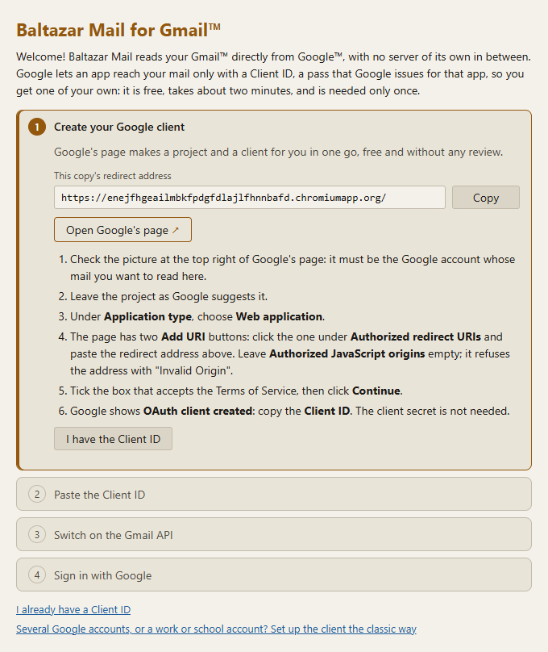
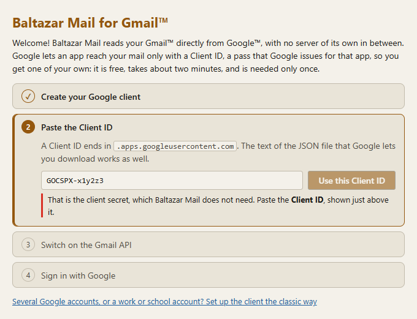
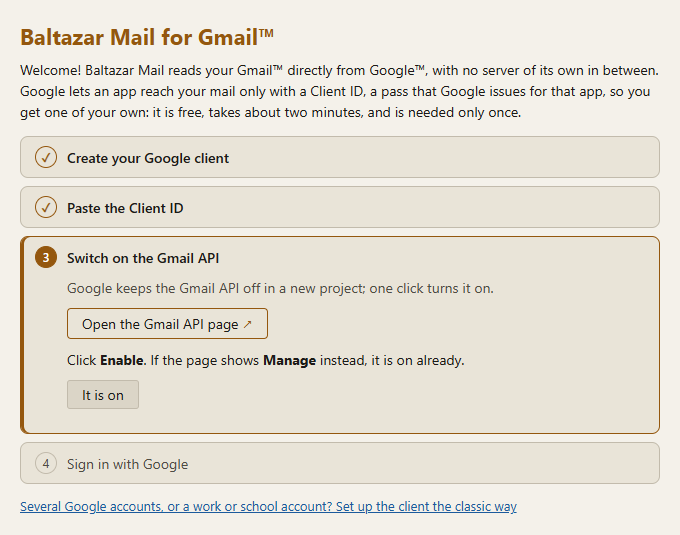
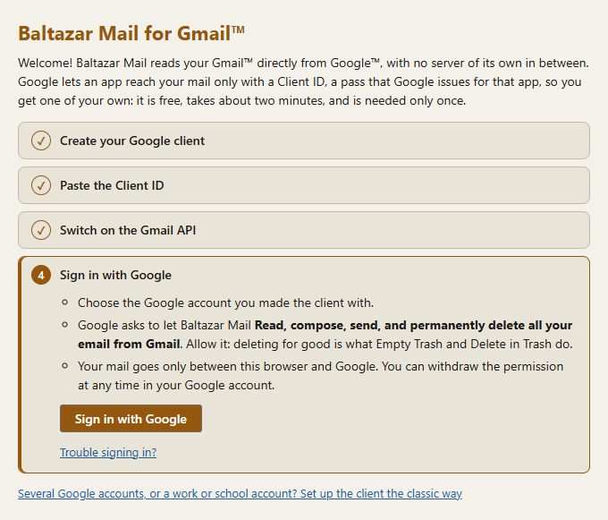
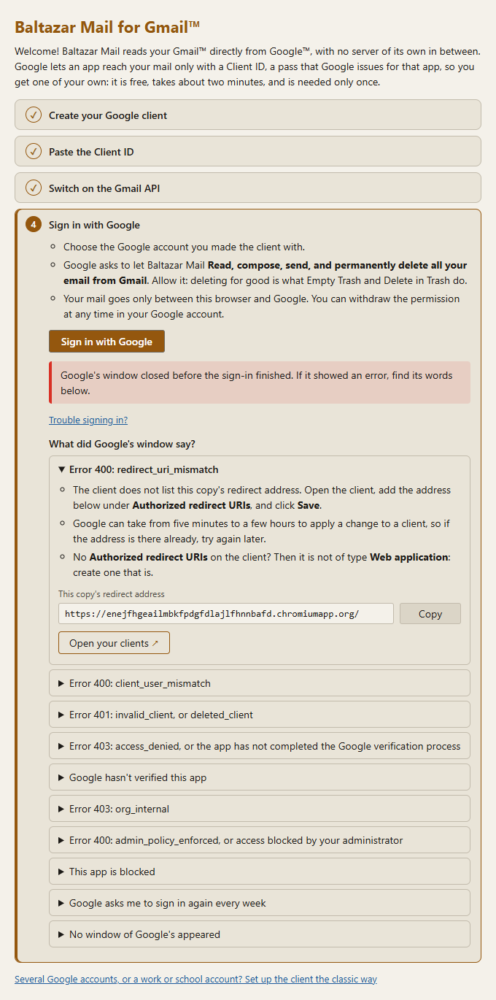
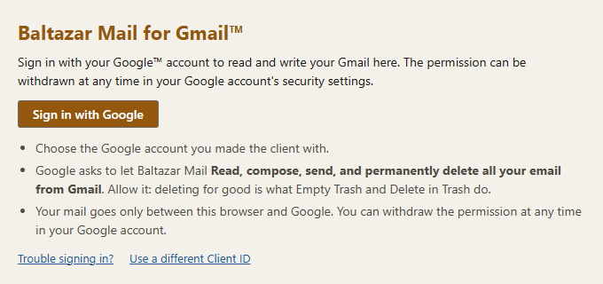

# Signing in to Baltazar Mail for Gmail™

The first time Baltazar Mail for Gmail starts, it opens its own tab, and its sign-in page walks you through a one-time setup: you make a Google™ client of your own on Google's pages, which takes about two minutes, and then sign in. This page shows each step as the extension shows it. The pictures are of the light theme; the page follows the theme you choose in Settings. The Client ID in them is invented. For the same steps as plain text, the classic setup for several accounts, and every error of Google's with its fix, see [google-setup.md](google-setup.md).

## Why a client of your own

Google lets an app reach a mailbox only through an OAuth client registered with Google, which it knows by its Client ID. Baltazar Mail has no server and no shared client, so you make one for yourself. The quick way, which the guide starts with, is Google's Personal mode: free, with no review by Google, no warning on Google's pages and no weekly expiry; only the Google account that made the client can sign in with it. Your mail then goes only between your browser and Google.

## 1. Create your Google client

Click **Copy** next to the redirect address, then **Open Google's page**: Google's Personal mode page opens in a new tab. Check that the picture at its top right is the Google account whose mail you want to read; with several accounts in the browser, switch to it there first. Choose **Web application**. The form has two **Add URI** buttons: click the one under **Authorized redirect URIs** and paste the address there; the other, under **Authorized JavaScript origins**, refuses it with "Invalid Origin", so leave that section empty. Accept the terms and click **Continue**. Google then shows the new client: copy its **Client ID** (the client secret is not needed), come back to this tab and click **I have the Client ID**.

The redirect address is the same for every copy installed from a release ZIP or built from the repository, `https://enejfhgeailmbkfpdgfdlajlfhnnbafd.chromiumapp.org/`; a copy from a browser store shows its own.

## 2. Paste the Client ID

Paste it into the box and click **Use this Client ID**, or press Enter. The box reads what you paste as you paste it: in the picture it is the client secret, which sits next to the Client ID on Google's page, and the page says so. It also recognizes the redirect address, an API key, a project number and an email address, takes the text of the JSON file that Google lets you download, and warns when that file's client does not list this copy's address.

## 3. Switch on the Gmail API

A new project has the Gmail API switched off. **Open the Gmail API page** opens it in the project of your client, which the page knows from the Client ID. Click **Enable** there; if it shows **Manage** instead, the API is on already. Back here, click **It is on**.

## 4. Sign in with Google

Click **Sign in with Google**. Google's window opens, and while it is open the page says it is waiting, since the window can come up behind the browser. Choose the account you made the client with, and allow what Google asks: to **Read, compose, send, and permanently delete all your email from Gmail**. Deleting for good is what Empty Trash and Delete in Trash need. The mailbox then opens, and the guide is done.

## If the sign-in does not work

The page stays, says what went wrong and what to do. When Google's window closed before the end, it may have shown an error of its own, which the extension cannot see: find its words under **What did Google's window say?** and open them for the fix. The most common is `redirect_uri_mismatch`, a client that does not list this copy's redirect address; its entry has the address to copy and a button to your clients. Google can take from five minutes to a few hours to apply a change to a client.

When Google signed you in but the Gmail API is still off, the page links to it and the button becomes **Continue**: switch the API on, wait a minute and press it, and the sign-in finishes without another Google window.

## Next time

The extension keeps you signed in while the browser holds your Google session. After **Sign out** in Settings, or when the browser's Google session ends, the page is a single button, since the Client ID stays. **Trouble signing in?** opens the same list of Google's errors, and **Use a different Client ID** goes back to the paste step.

## The address book

Contacts and the address suggestions while you write come from your own Inbox and Sent, which the extension reads over time so that it never slows you down: it starts two minutes after you first sign in, then reads a little at a time, only once you have left the app alone for a minute or are in another tab. That takes about 40 minutes of such time all together, spread over as many sessions as it needs; Contacts and suggestions fill in as it goes, and Contacts says above its list while it is still being built.

## Other ways in

- **I already have a Client ID**, under the steps, goes straight to the paste step, for a client made earlier or for another copy; add this copy's redirect address to that client first.
- **Several Google accounts, or a work or school account?** switches the guide to the classic setup, which makes an app that any of your accounts, or every account of your organization, can sign in to; [google-setup.md](google-setup.md#the-classic-way-an-app-for-several-accounts) has its steps as text.
